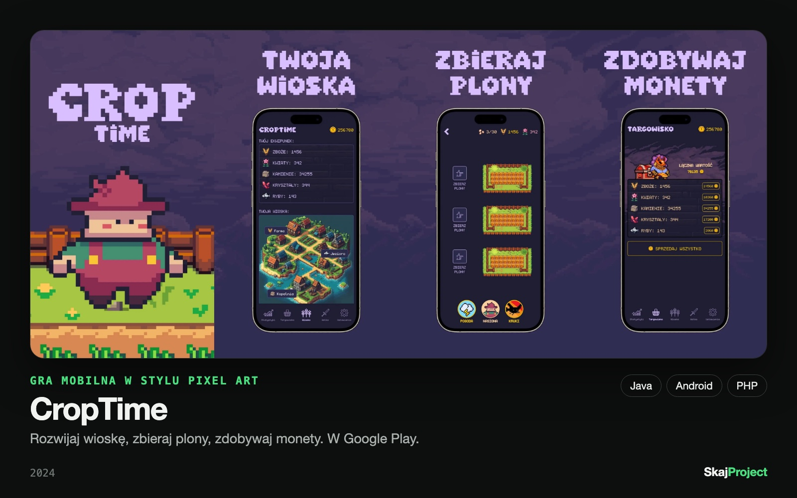

# CropTime

> 🔒 Kod źródłowy CropTime jest prywatny. To repozytorium pokazuje grę, stack i decyzje techniczne.

**Gra mobilna w stylu pixel art.** Rozwijasz wioskę, uprawiasz rośliny, wydobywasz surowce, łowisz ryby i sprzedajesz zbiory na targowisku.

[▶ Google Play](https://play.google.com/store/apps/details?id=com.skajgames.croptime) · ponad 1 tys. pobrań (według strony w Google Play, stan na 11.11.2026)

## Co w niej jest

- Wioska z farmą, jeziorem i kopalnią
- Uprawa i zbiór plonów
- Targowisko z wyceną surowców
- Konto gracza (logowanie przez Firebase)

## Stack

| Warstwa | Technologie |
|---|---|
| Aplikacja | Java, Android (min SDK 26) |
| Konto i konfiguracja | Firebase Authentication, Remote Config, Analytics |
| Backend | PHP |
| Monetyzacja | Reklamy (AdMob, Unity Ads, AppLovin), zgoda użytkownika przez UMP |

## Ciekawostka techniczna: przerwa techniczna sterowana z serwera

Aplikacja na Androidzie rozmawia z backendem w PHP. Gdy serwer jest wyłączony na czas prac, gra przechodzi na osobny ekran przerwy technicznej z komunikatem pobieranym z serwera. Dzięki temu informację dla graczy można zmienić bez wydawania nowej wersji aplikacji.

## Autor

Piotr Woźniak · [SkajProject](https://skajproject.com), własny projekt (wydawca w Google Play: SkajGames).
